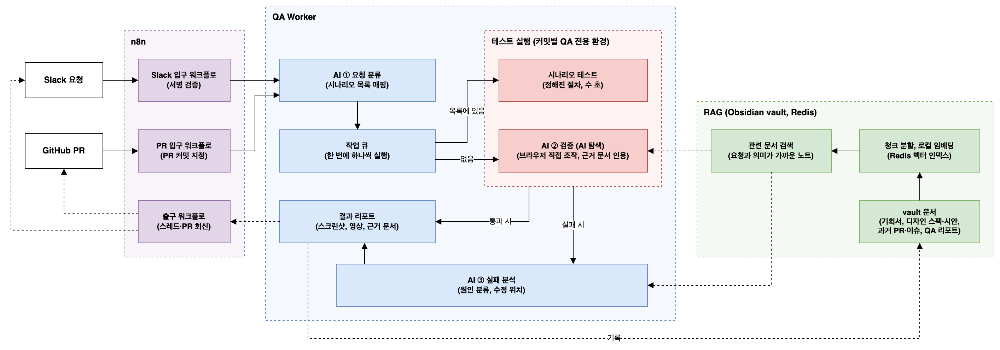
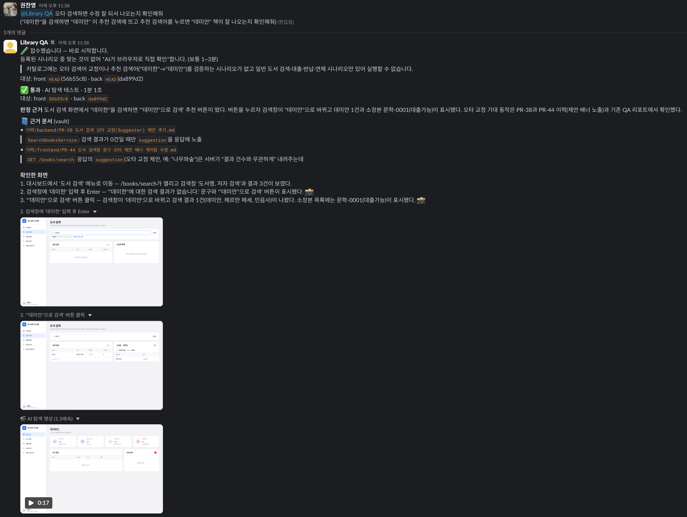

## Library QA

Slack에 자연어로 요청하면 도서관 관리 시스템(프론트엔드와 백엔드)을 **사용자 관점에서 풀스택으로 검증**하고 스크린샷, 영상, 근거 문서와 함께 결과를 회신하는 QA 서비스입니다.

등록된 시나리오가 있으면 시나리오 테스트(pytest-playwright)로, 없으면 AI가 브라우저를 직접 조작하는 AI 탐색 테스트(Claude Code + Playwright MCP)로 검증합니다. 실패하면 별도의 분석 AI가 원인과 수정 위치를 추천합니다.

## 서비스 아키텍처

## 기술 블로그
- 자연어로 요청하는 AI QA 시스템 만들기 - [Notion 문서 링크](https://chanyoung-kwon.notion.site/AI-38fe5ea23d6b80799d4bea4ba8dff361?source=copy_link)

## 요청 예시

> **@Library QA** 오타 검색하면 수정 잘 되서 나오는지 확인해줘 
> ("데미한"을 검색하면 "데미안"이 추천 검색에 뜨고 추천 검색어를 누르면 "데미안" 책이 잘 나오는지 확인해줘)

- **Slack 결과 회신** — 판정, 근거 문서, 확인한 화면, 영상

  

  - **판정 근거 화면** — AI가 브라우저를 조작하며 남긴 스크린샷

    <table width="75%">
      <tr>
        <th width="50%">"데미한" 검색 → 추천 검색어 표시</th>
        <th width="50%">추천 검색어 클릭 → "데미안" 검색 결과</th>
      </tr>
      <tr>
        <td></td>
        <td></td>
      </tr>
    </table>

  - **테스트 영상** — AI 탐색 전체 과정 (1.5배속)

    https://github.com/user-attachments/assets/98bd778e-e871-4955-8a6c-d34384d3870b

## 기술 스택
- **Language & build tool**
  -  
- **Framework**
  -   
- **Queue & Vector DB**
  - 
- **AI**
  -  
- **Workflow & Infra**
  -   
- **Knowledge base**
  -  
- **Communication tool**
  -   

## 실행 방법

구성 요소와 포트, 설치, 작업 API, Slack 연동 설정은 [운영 가이드](docs/operation.md)에 정리했습니다.
